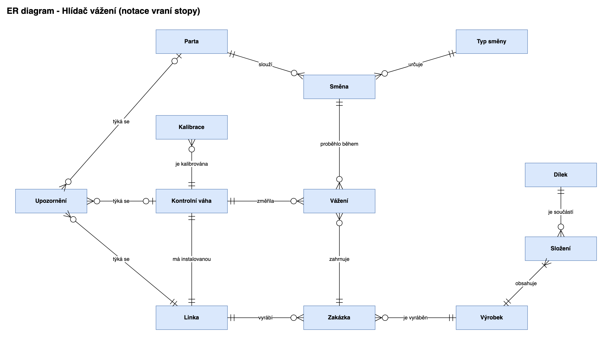
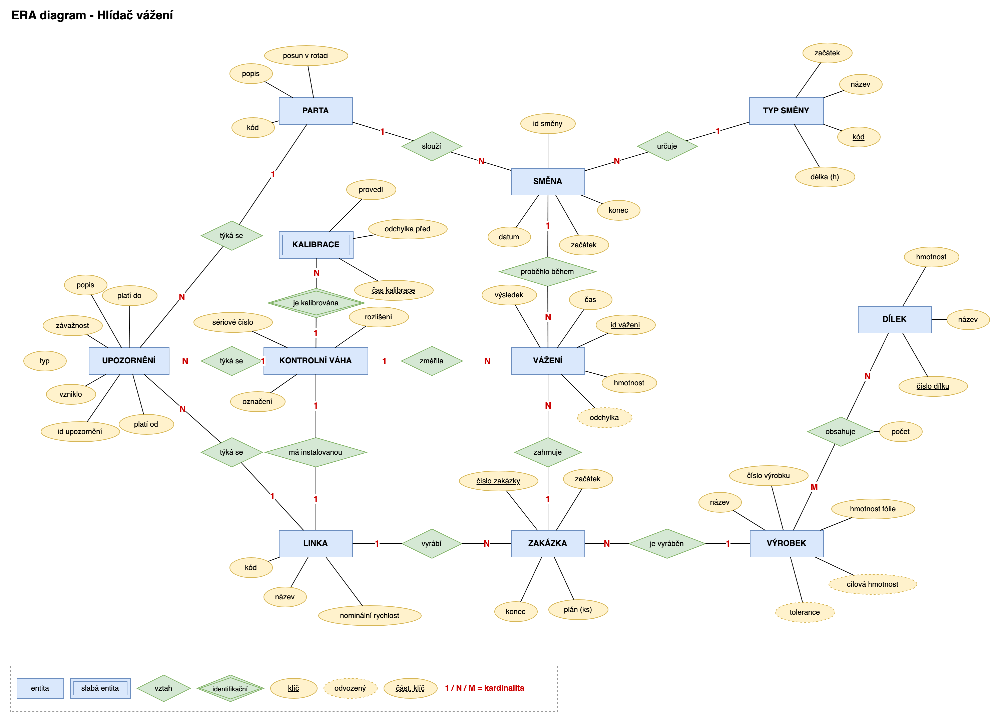

# Konceptuální model (ER a ERA diagram)

Tady je, co si systém eviduje, ještě bez ohledu na konkrétní databázi. Názvy jsou česky, protože jde o pojmy z provozu. Jak se z toho staly tabulky, je v [03 - Logické schéma](03_logicke_schema.md).

## ER diagram

Přehled entit a vztahů v notaci vraní stopy (Crow's Foot): svislá čárka = právě jeden, kolečko = nula, vidlička = více.

Nakreslené v draw.io: [diagrams/er.drawio](diagrams/er.drawio)

## ERA diagram

Podrobnější model v Chenově notaci: entity jsou obdélníky, vztahy kosočtverce a atributy ovály.

Nakreslené v draw.io: [diagrams/era.drawio](diagrams/era.drawio)

Pár poznámek k diagramu:

- Podtržený atribut je identifikátor.
- **Kalibrace je slabá entita** (dvojitý obdélník). Sama se nedá identifikovat, pozná se až podle váhy a času kalibrace. Proto je čas kalibrace podtržený čárkovaně a vztah "je kalibrována" je identifikační (dvojitý kosočtverec).
- Čárkovaný ovál je **odvozený atribut**. Neukládá se, počítá se: cílová hmotnost a tolerance výrobku ze složení, odchylka vážení z hmotnosti a cíle.
- Vztah výrobek-dílek je **M:N** a má vlastní atribut **počet**. V logickém schématu z něj je samostatná tabulka.

## Entity

| Entita | Co to je | Identifikátor | Atributy |
|---|---|---|---|
| Linka | balicí linka | kód (PP-01...) | název, nominální rychlost |
| Kontrolní váha | váha na konci linky | označení (CW-101...) | sériové číslo, rozlišení |
| Kalibrace | záznam o kalibraci (slabá entita) | váha + čas | odchylka před kalibrací, kdo ji dělal |
| Výrobek | druh sáčku | číslo výrobku | název, hmotnost fólie, *cílová hmotnost*, *tolerance* |
| Dílek | druh dílku | číslo dílku | název, hmotnost |
| Parta | lidi, kteří jezdí směny spolu | kód (A-D) | posun v rotaci, popis |
| Typ směny | denní / noční | kód (D, N) | název, začátek, délka |
| Směna | konkrétní směna v kalendáři | id | datum, začátek, konec |
| Zakázka | výroba jednoho výrobku na jedné lince | číslo zakázky | začátek, konec, plánované množství |
| Vážení | jedno zvážení jednoho sáčku | id | čas, hmotnost, výsledek, *odchylka* |
| Upozornění | co analýza našla | id | kdy vzniklo, typ, závažnost, popis, od-do |

## Vztahy

| Vztah | Mezi | Kardinalita | Poznámka |
|---|---|---|---|
| má instalovanou | linka - váha | 1:1 | na každé lince je právě jedna váha |
| je kalibrována | váha - kalibrace | 1:N | historie kalibrací |
| vyrábí | linka - zakázka | 1:N | |
| je vyráběn | výrobek - zakázka | 1:N | |
| obsahuje | výrobek - dílek | M:N + počet | složení sáčku |
| slouží | parta - směna | 1:N | kdo směnu jel |
| určuje | typ směny - směna | 1:N | |
| zahrnuje | zakázka - vážení | 1:N | |
| změřila | váha - vážení | 1:N | důležité kvůli kalibraci: posun je vlastnost váhy, ne linky |
| proběhlo během | směna - vážení | 1:N | přes směnu se dohledá parta |
| týká se | linka / váha / parta - upozornění | 1:N | linka vždycky, váha a parta jen u některých typů |

## Pravidla, která musí platit

Na tahle čísla odkazuju v kódu a v testech.

- **IO1:** cílová hmotnost výrobku = součet (počet × hmotnost dílku) + hmotnost fólie
- **IO2:** tolerance = polovina hmotnosti nejlehčího dílku v sáčku
- **IO3:** vážení je OK, když |hmotnost - cíl| ≤ tolerance, jinak podváha nebo nadváha. Ukládá se výsledek tak, jak ho váha v tu chvíli vyhodnotila.
- **IO4:** čas vážení je uvnitř své zakázky i své směny
- **IO5:** zakázky na jedné lince se nepřekrývají
- **IO6:** směny se nepřekrývají a navazují na sebe
- **IO7:** partu směny určuje rotace 2-2-4: parta s posunem *p* jede v den *d* denní, když (d - p) mod 8 je 0 nebo 1, a noční, když je 2 nebo 3
- **IO8:** počet dílků ve složení je aspoň 1, hmotnosti a rychlosti jsou kladné
- **IO9:** jedna váha nemá dvě kalibrace ve stejný okamžik
- **IO10:** upozornění: "od" ≤ "do", závažnost je info / varování / kritické

## Proč jsem to udělal takhle

- **Parta je samostatná entita, ne jen písmeno u směny.** Party se mezi sebou porovnávají a upozornění se může týkat přímo party.
- **Typ směny je zvlášť.** Začátek a délka směny jsou tak na jednom místě, takže kdyby se změnily časy směn, mění se jeden řádek.
- **Zaměstnance jsem vynechal.** Na analýzu stačí parta a nemusím řešit osobní údaje.
- **Vážení odkazuje na váhu i na zakázku.** Linku zjistím přes zakázku, ale váhu potřebuju zvlášť, protože posun kalibrace je vlastnost váhy (ta se může přestěhovat na jinou linku).
- **Upozornění jsou v databázi.** Jde zpětně dohledat, co systém kdy hlásil, a dají se napojit další věci (Power BI, Teams).
