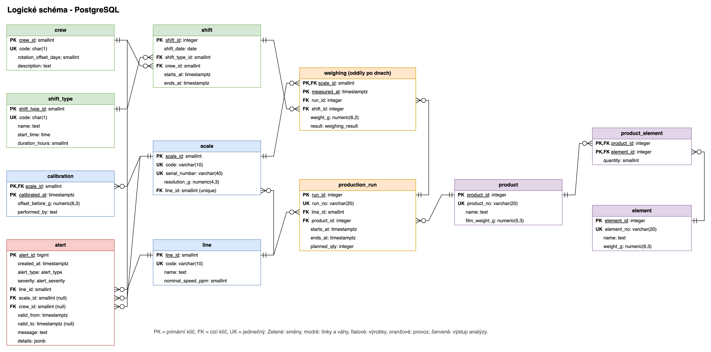

# Logické schéma

Převod konceptuálního modelu na tabulky v PostgreSQL 16: názvy, datové typy, klíče a omezení. SQL je v [db/migrations](../db/migrations/).

V databázi používám anglické názvy (`line`, `weighing`...), v dokumentaci píšu česky.

## Z entit tabulky

| Entita | Tabulka | Poznámka |
|---|---|---|
| Linka | `line` | |
| Kontrolní váha | `scale` | vztah 1:1 s linkou = `line_id` s `UNIQUE` |
| Kalibrace (slabá entita) | `calibration` | složený primární klíč (`scale_id`, `calibrated_at`) |
| Výrobek | `product` | cílová hmotnost a tolerance se počítají v pohledu `v_product_spec` |
| Dílek | `element` | |
| vztah výrobek-dílek (M:N) | `product_element` | vazební tabulka s atributem `quantity` |
| Parta | `crew` | |
| Typ směny | `shift_type` | |
| Směna | `shift` | |
| Zakázka | `production_run` | |
| Vážení | `weighing` | největší tabulka, rozdělená po dnech |
| Upozornění | `alert` | |

## Relační schéma

Primární klíč **tučně**, cizí klíč *kurzívou*.

- line (**line_id**, code, name, nominal_speed_ppm)
- scale (**scale_id**, code, serial_number, resolution_g, *line_id*)
- calibration (***scale_id***, **calibrated_at**, offset_before_g, performed_by)
- element (**element_id**, element_no, name, weight_g)
- product (**product_id**, product_no, name, film_weight_g)
- product_element (***product_id***, ***element_id***, quantity)
- crew (**crew_id**, code, rotation_offset_days, description)
- shift_type (**shift_type_id**, code, name, start_time, duration_hours)
- shift (**shift_id**, shift_date, *shift_type_id*, *crew_id*, starts_at, ends_at)
- production_run (**run_id**, run_no, *line_id*, *product_id*, starts_at, ends_at, planned_qty)
- weighing (***scale_id***, **measured_at**, *run_id*, *shift_id*, weight_g, result)
- alert (**alert_id**, created_at, alert_type, severity, *line_id*, *scale_id*, *crew_id*, valid_from, valid_to, message, details)

Kódy (`code`, `product_no`, `element_no`, `run_no`) jsou navíc `UNIQUE`. U směny je jedinečná dvojice (datum, typ směny).

Nakreslené v draw.io: [diagrams/logicke_schema.drawio](diagrams/logicke_schema.drawio)

## Důležité sloupce a omezení

| Sloupec | Typ | Omezení |
|---|---|---|
| `scale.line_id` | smallint | NOT NULL, UNIQUE, FK. Na lince je právě jedna váha. |
| `element.weight_g` | numeric(6,3) | > 0 |
| `product_element.quantity` | smallint | ≥ 1 |
| `crew.code` | char(1) | jedno velké písmeno |
| `crew.rotation_offset_days` | smallint | 0-7, posun party v osmidenním cyklu |
| `shift.starts_at`, `ends_at` | timestamptz | konec > začátek, `EXCLUDE`: směny se nepřekrývají |
| `production_run.starts_at`, `ends_at` | timestamptz | `EXCLUDE (line_id WITH =, interval WITH &&)`: zakázky na jedné lince se nepřekrývají |
| `weighing.weight_g` | numeric(6,2) | > 0 |
| `weighing.result` | enum `weighing_result` | OK, UNDER, OVER |
| `alert.scale_id`, `crew_id` | smallint | nepovinné. CHECK: drift musí mít váhu, problém party musí mít partu |
| `alert.details` | jsonb | čísla, ze kterých upozornění vzniklo |

Která pravidla z konceptuálního modelu hlídá databáze:

- IO5 a IO6 hlídá `EXCLUDE` (potřebuje rozšíření `btree_gist`),
- IO8 a IO10 hlídá `CHECK`,
- IO9 hlídá primární klíč kalibrace,
- IO1 a IO2 počítá pohled `v_product_spec`.

IO4 a IO7 hlídá kód při zápisu a ověřují je testy. Kontrola přímo v databázi by u milionů řádků zbytečně zpomalovala zápis.

## Normalizace

- **1NF:** v každém sloupci je jedna hodnota. Složení sáčku není seznam v jednom sloupci, ale řádky v `product_element`.
- **2NF:** `quantity` závisí na celém klíči (výrobek + dílek). U kalibrace závisí všechno na dvojici (váha, čas).
- **3NF:** odvozené věci (cílová hmotnost, tolerance, odchylka) se neukládají, počítají se v pohledech. Hmotnost dílku je jen u dílku.
- **BCNF:** každý determinant je kandidátní klíč (např. `code`).

### Kde jsem 3NF schválně porušil

1. **`weighing.shift_id`:** směna se dá dopočítat z času vážení. Kdybych ji ale neukládal, musel bych u každého dotazu spojovat miliony řádků podle časového intervalu. Že sedí, hlídá test `test_weighing_shift_consistency`.
2. **`shift.crew_id`:** parta by šla dopočítat z rotace. Ve skutečnosti se ale party prohazují (dovolená, výměna směn), takže kalendář je záznam toho, kdo opravdu jel, ne výpočet.

### Proč vážení nemá id

V ERA diagramu má vážení identifikátor. V tabulce jsem ho nahradil dvojicí (`scale_id`, `measured_at`), protože jedna váha nezváží dva sáčky ve stejné milisekundě. Má to dva důvody:

- PostgreSQL chce, aby primární klíč rozdělené tabulky obsahoval sloupec, podle kterého se dělí (`measured_at`),
- ušetřím sloupec a jeden index, což je u 7 milionů řádků znát.

## Pohledy pro analýzu

| Objekt | Co v něm je |
|---|---|
| `v_product_spec` | cílová hmotnost (IO1) a tolerance (IO2) výrobků |
| `mv_hourly_stats` | materializovaný pohled: souhrn po hodinách pro každou kombinaci váha x zakázka x směna (počty, výmět, průměrná odchylka dobrých sáčků, zvlášť prvních 20 minut zakázky) |
| `v_scale_hourly` | hodinový průměr odchylky a výmět každé váhy (podklad pro regulační diagram) |
| `v_quality_by_crew` | podváha bez rozběhů podle linky x typu směny x party |
| `v_rampup_by_line` | výmět při rozběhu a v běžném provozu podle linky |

Materializovaný pohled se obnoví po nahrání dat. Analýza a report pak pracují se 3 tisíci řádků místo 7 milionů.

## Fyzický návrh

### Rozdělení tabulky vážení

`weighing` je rozdělená po dnech (`PARTITION BY RANGE (measured_at)`): co den, to oddíl `weighing_YYYYMMDD`, a k tomu oddíl `weighing_default` pro data mimo. Oddíly zakládá funkce `create_weighing_partitions(od, do)`.

- Dotaz na konkrétní den nebo pár hodin čte jen jeden oddíl.
- Stará data se smažou odpojením celého dne místo pomalého `DELETE`.

### Hromadné nahrávání

Při `COPY` milionů řádků databáze kontrolovala cizí klíče u každého řádku zvlášť a nahrávání trvalo 4,5 minuty. Migrace `003_bulk_load.sql` proto má dvě funkce:

- `weighing_bulk_load_begin()` dočasně odebere cizí klíče a vedlejší indexy (primární klíč zůstane),
- `weighing_bulk_load_end()` je vrátí a databáze je zkontroluje najednou.

Obojí běží v jedné transakci s `COPY`, takže když se něco pokazí, vrátí se všechno. Nahrání teď trvá 18 s.

### Indexy

| Index | Na co |
|---|---|
| PK (`scale_id`, `measured_at`) | vážení jedné váhy v čase (regulační diagram) |
| (`run_id`, `measured_at`) | začátky zakázek (rozběh) |
| BRIN (`measured_at`) | časový rozsah přes všechny váhy. Je malinký, protože data přibývají v čase. |
| GiST (`EXCLUDE`) | hlídání, aby se směny a zakázky nepřekrývaly |
| UNIQUE na `mv_hourly_stats` | rychlé hledání a možnost `REFRESH ... CONCURRENTLY` |

### Časová pásma

Všechny časy jsou `timestamptz` v pásmu Europe/Prague. Směny počítám v místním čase, takže při změně času má noční směna správně 11 nebo 13 hodin. Testuju to, i když ve simulovaném období (5.-21. 10.) změna času není.

### Kolik je to dat

| Tabulka | Řádků za 16 dní | Velikost |
|---|---|---|
| `weighing` | 6 878 640 | 451 MB, s indexy 867 MB |
| `mv_hourly_stats` | 3 262 | 0,6 MB |
| ostatní | stovky | nic |
