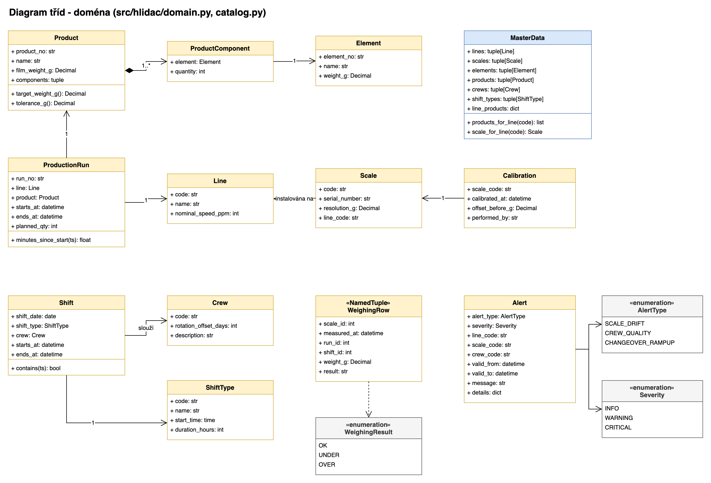
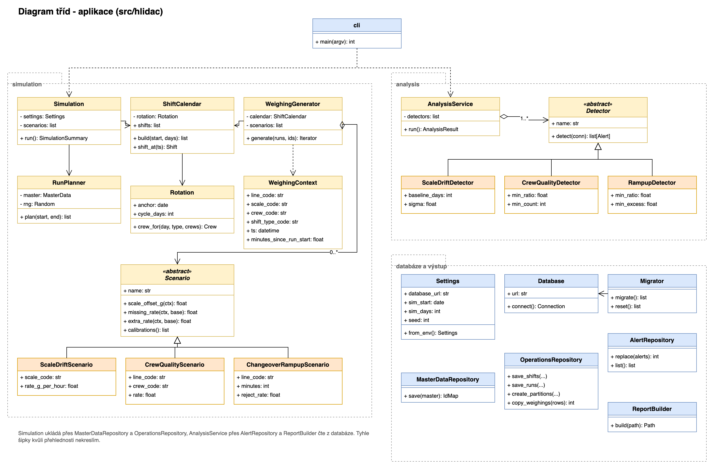

# Diagram tříd

Kód je v Pythonu (3.9+) ve složce [src/hlidac](../src/hlidac/). Rozdělil jsem ho na dvě části:

- **doména:** obyčejné datové třídy, které odpovídají entitám z ERA diagramu,
- **aplikace:** simulace, analýza, práce s databází, report a příkazová řádka.

## Doména

Nakreslené v draw.io: [diagrams/tridy_domena.drawio](diagrams/tridy_domena.drawio)

| Třída | Tabulka | Poznámka |
|---|---|---|
| `Line`, `Scale` | `line`, `scale` | linka a její váha |
| `Element`, `ProductComponent`, `Product` | `element`, `product_element`, `product` | výrobek a složení. `target_weight_g()` a `tolerance_g()` počítají to samé co pohled `v_product_spec` (a test hlídá, že vyjde stejné číslo). |
| `Crew`, `ShiftType`, `Shift` | `crew`, `shift_type`, `shift` | party a směny |
| `ProductionRun` | `production_run` | zakázka |
| `Calibration` | `calibration` | kalibrace váhy |
| `WeighingRow` | `weighing` | jedno vážení. Je to `NamedTuple`, protože jich vzniknou miliony a musí být co nejlehčí. |
| `Alert` | `alert` | upozornění + výčty `AlertType` a `Severity` |
| `MasterData` | - | všechna kmenová data pohromadě (v `catalog.py`) |

Doménové třídy o databázi nic neví. Do tabulek je ukládají třídy v `repository.py`.

## Aplikace

Nakreslené v draw.io: [diagrams/tridy_aplikace.drawio](diagrams/tridy_aplikace.drawio)

| Modul | Třídy | Co dělá |
|---|---|---|
| `config` | `Settings` | nastavení z `.env` |
| `db` | `Database`, `Migrator` | připojení a spouštění SQL migrací v pořadí |
| `shifts` | `Rotation`, `ShiftCalendar` | kdo jede kterou směnu (2-2-4) a hledání směny podle času |
| `simulation.planner` | `RunPlanner` | plán zakázek: 4-10 h, přestavby 20-40 min |
| `simulation.scenarios` | `Scenario` a potomci | ty tři schované problémy S1-S3 |
| `simulation.generator` | `WeighingGenerator` | jednotlivá vážení (hmotnost, chybějící/přebývající dílek, šum váhy) |
| `simulation.simulation` | `Simulation` | spojí všechno dohromady a uloží do databáze |
| `repository` | `MasterDataRepository`, `OperationsRepository`, `AlertRepository` | zápis a čtení. Vážení jdou přes `COPY`. |
| `analysis` | `Detector` a potomci, `AnalysisService` | hledání problémů |
| `report` | `ReportBuilder` | HTML report s grafy |
| `cli` | `main` | `migrate`, `reset`, `simulate`, `analyze`, `report`, `all` |

### Detektory

**ScaleDriftDetector** (rozkalibrovaná váha):
- z prvních 4 dní spočítá pro každou váhu průměr a směrodatnou odchylku hodinové odchylky dobrých sáčků,
- ozve se, když jsou 2 hodiny po sobě mimo průměr ± 3σ,
- hodina, kdy váha vyhodí víc než polovinu sáčků, se taky počítá jako mimo.

**CrewQualityDetector** (parta):
- porovná podváhu party (bez rozběhů) s mediánem ostatních part na stejné lince a stejném typu směny,
- ozve se při aspoň 2,5x vyšší hodnotě a rozdílu aspoň 0,5 procentního bodu,
- podívá se i na stejnou partu na druhé směně, aby poznal, jestli jde o partu, nebo o noc.

**RampupDetector** (rozběh):
- spočítá, o kolik je výmět v prvních 20 minutách zakázky vyšší než v běžném provozu té samé linky,
- porovná to s mediánem ostatních linek, ozve se při 3x víc a aspoň 3 procentních bodech,
- první verze porovnávala jen samotný výmět při rozběhu a omylem hlásila i PP-05. Ta měla vysoký výmět pořád, kvůli rozkalibrované váze.

## Proč je to takhle rozdělené

- `Scenario` a `Detector` jsou abstraktní třídy s potomky (vzor strategie). Nový problém do simulace nebo nový detektor je jen nová třída, nic jiného se nemusí měnit.
- SQL je jen v `repository.py`, v detektorech a v reportu. Doménové třídy jsou čisté.
- `Simulation` a `AnalysisService` mají jednu metodu `run()`, příkazová řádka volá jen je.
- `WeighingGenerator` dostane scénáře a kalendář v konstruktoru, takže jde testovat bez databáze.
- Generátor vážení používá `yield`, takže se miliony řádků nikdy nedrží v paměti najednou a rovnou tečou do `COPY`.

## Co by šlo přidat

- **skutečná data:** místo `WeighingGenerator` třída, která čte vážení z výrobního systému a dává stejné `WeighingRow` do `copy_weighings`,
- **další detektor** (třeba jestli se přesnost zhoršuje ke konci dvanáctky): nový potomek `Detector`,
- **upozornění do Teams:** čte nové řádky z tabulky `alert` a posílá je dál.
