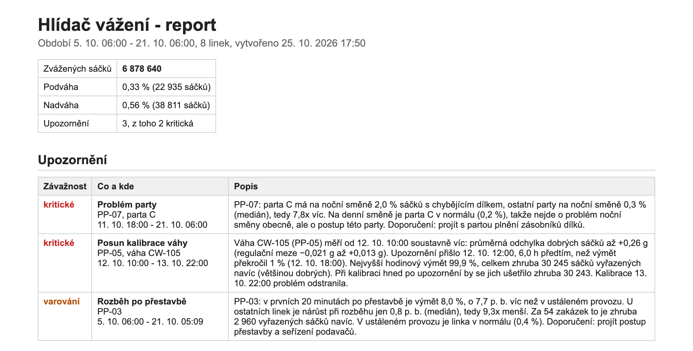
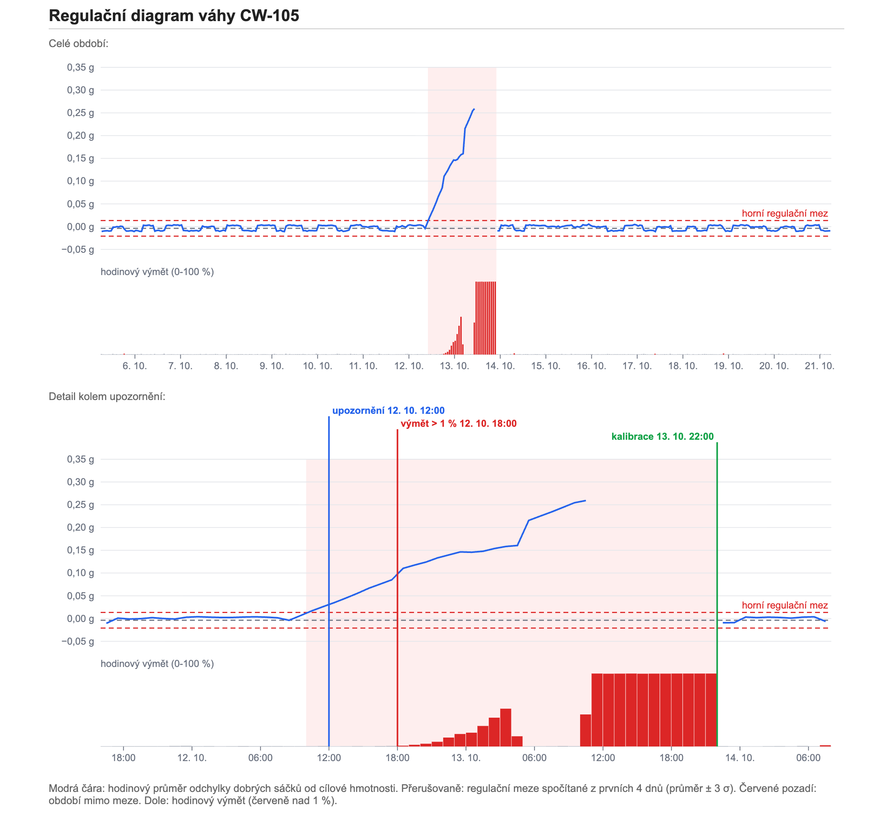

# Výsledky

Měřeno na mém MacBooku (Apple Silicon) s Dockerem, PostgreSQL 16 a Pythonem 3.9. Data jsou simulace od 5. 10. 2026 6:00 do 21. 10. 2026 6:00 se seedem 42, takže by vám měla vyjít stejná čísla.

## Splnil jsem, co jsem si dal za cíl?

| Cíl ze zadání | Jak to dopadlo |
|---|---|
| `make all` udělá všechno od začátku | ano, celé to trvá asi 20 s |
| najít všechny tři problémy a nic navíc | ano, přesně 3 upozornění (hlídá to test `test_full_period_finds_exactly_the_three_situations`) |
| rozkalibrovaná váha aspoň 2 h předem | ano, **6 hodin** předem |
| parta C jako problém party, ne noci | ano, upozornění přímo říká, že ve dne je parta C v pořádku |
| dotazy pod 1 s | ano, 0,67 s přímo nad váženími, 0,8 ms nad souhrny |
| testy projdou | ano, 22 z 22 |

## Co analýza našla



**Rozkalibrovaná váha CW-105:** posun začal 12. 10. v 8:00. Od 10:00 je váha mimo regulační meze a upozornění přišlo ve 12:00. Výmět přelezl 1 % až v 18:00, takže náskok je 6 hodin. Kdyby se nic nedělalo, do kalibrace 13. 10. ve 22:00 se vyhodí asi 30 000 sáčků navíc, většinou dobrých.

**Parta C na PP-07:** v noci má 2,0 % sáčků s chybějícím dílkem, ostatní party v noci 0,3 %. Ve dne má parta C 0,2 %, takže to není noční směnou.

**Rozběh na PP-03:** v prvních 20 minutách po přestavbě je výmět 8 %, tedy o 7,7 procentního bodu víc než v běžném provozu. U ostatních linek je to kolem 0,8 bodu. Za 54 zakázek to dělá asi 2 960 vyhozených sáčků navíc.

### Regulační diagram



Modrá čára (průměrná odchylka dobrých sáčků) uteče z mezí mnohem dřív, než se objeví výmět (červené sloupce dole). Přesně kvůli tomu má smysl sledovat průměr, a ne jen počet vyhozených sáčků.

### Falešné upozornění, na které jsem narazil

První verze detektoru rozběhu hlásila kromě PP-03 i PP-05. Jenže PP-05 měla vysoký výmět i při rozbězích jen proto, že jí zrovna ujela váha (S1). Detektor jsem upravil, aby porovnával **nárůst** výmětu při rozběhu proti běžnému provozu té samé linky. PP-05 zmizela a PP-03 zůstala.

## Rychlost

Měří to [scripts/benchmark.py](../scripts/benchmark.py) (medián ze tří `EXPLAIN ANALYZE`).

| Co | Čas |
|---|---|
| nahrání 6,9 mil. vážení, když se cizí klíče kontrolují u každého řádku | 276 s |
| nahrání s dočasně odebranými cizími klíči | **17,6 s** |
| výmět podle part přímo z vážení | 669 ms (na jednom jádře 1 830 ms) |
| to samé z hodinových souhrnů | **0,8 ms** |
| jedna váha, 6 hodin | 2,7 ms, čte se jen 1 denní oddíl z 18 |
| všechny váhy, jeden den | 23,5 ms |
| obnovení hodinových souhrnů | 1,5 s |
| celá analýza | 1,7 s |

Velikosti:

| | |
|---|---|
| tabulka `weighing` | 451 MB, s indexy 867 MB |
| primární klíč (B-strom) | 207 MB |
| index na zakázky (B-strom) | 207 MB |
| BRIN index na čas | **0,4 MB** |
| hodinové souhrny | 0,6 MB, 3 262 řádků |

Zajímavé je, jak malý je BRIN: zhruba 500x menší než normální index. Funguje to, protože vážení přibývají v čase, takže mu stačí pamatovat si pro každý blok dat jen rozsah času.

## Testy

```
HLIDAC_FULL=1 pytest -v
22 passed in 32.27s
```

- `test_shifts.py` (6): rotace 2-2-4, každou směnu jede právě jedna parta, kalendář navazuje, každá parta má 4 denní a 4 noční, **noční přes změnu času má 13 hodin**, hranice směn
- `test_domain_and_planner.py` (4): cílová hmotnost a tolerance, zaokrouhlení, tolerance pozná chybějící nejlehčí dílek, zakázky se nepřekrývají
- `test_generator.py` (6): stejný seed = stejná data, výsledek sedí s tolerancí, čas roste, směna sedí, výmět je realistický, scénáře fungují
- `test_database.py` (6): pohled `v_product_spec` vychází stejně jako Python, databáze odmítne špatná data (EXCLUDE, UNIQUE, CHECK), konzistence dat po simulaci, oddíly, cizí klíče po nahrání, a test nad celým obdobím

## Omezení

- **Data jsou simulovaná.** Rozptyl vah, běžný výmět atd. jsem odhadl. Se skutečnými daty by se musely doladit prahy.
- **První 4 dny beru jako normální provoz.** Ve skutečnosti by se meze počítaly od poslední kalibrace.
- **Meze jsou pro celou váhu, ne pro každý výrobek.** Přesnější by byly meze pro každý výrobek zvlášť, nebo metody jako EWMA a CUSUM, které líp poznají pomalý posun.
- **Analýza běží jednou nad celým obdobím,** ne průběžně.

## Co dál

1. napojit skutečná data místo simulace,
2. zpracovávat průběžně (dávky po pár minutách, `REFRESH ... CONCURRENTLY`, detektory každou čtvrthodinu),
3. upozornění do Teams a dashboard v Power BI,
4. zkusit, jestli se přesnost zhoršuje ke konci dvanáctky.
